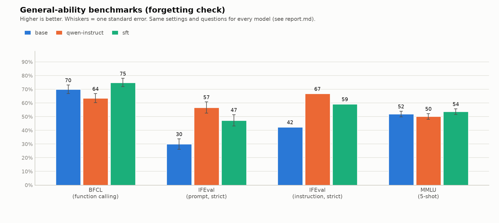
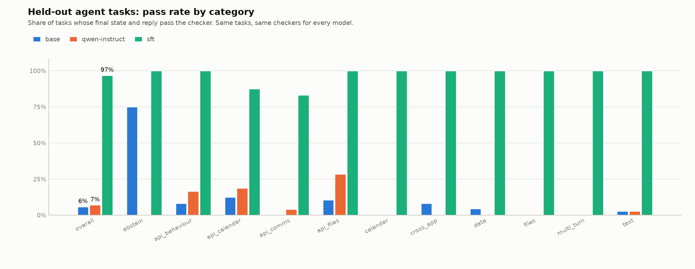

# post-train

Post-training `Qwen/Qwen3.5-0.8B-Base` into a tool-using assistant: full-parameter SFT on a verified mix of synthetic, teacher-written and real data
(done, results below); RL (GRPO) is planned and not implemented yet.

Model: <https://huggingface.co/msdkarimi/qwen3.5-0.8b-sft> (weights plus the raw result files under `results/`).

## Results

One full-fine-tuning run on one A100-80GB: 60,119 training examples, 1 epoch (1,879 optimizer steps, effective batch 32), 1 h 45 min, peak learning rate 1e-5
with cosine decay, validation loss 0.582 (step 200) to 0.404 (end), no source got worse. GPU cost was under $8. Three models were evaluated the same way:
the **base** model (`Qwen3.5-0.8B-Base`, the starting point), **Qwen's own instruct model** (`Qwen3.5-0.8B`, post-trained by the Qwen team from the same base), and the
**SFT** model from this repo.

| | base | Qwen instruct | **SFT (this repo)** |
|---|---|---|---|
| Held-out agent tasks, pass rate (252 tasks) | 5.9% | 7.1% | **96.8%** |
| Tool errors per call (agent tasks) | 0.648 | 0.652 | **0.063** |
| BFCL function calling (200 questions) | 70.0% | 63.5% | **75.0%** |
| BFCL simple / multiple / parallel / parallel-multiple | 67.5 / 77.5 / 50.0 / 75.0 | 75.0 / 62.5 / 45.0 / 67.5 | **87.5 / 80.0 / 72.5 / 77.5** |
| BFCL irrelevance (should not call a tool) | **80.0%** | 67.5% | 57.5% |
| IFEval, whole prompt strict (150 questions) | 30.0% | **56.7%** | 47.3% |
| IFEval, per instruction strict | 42.4% | **66.8%** | 59.2% |
| MMLU, 5-shot (570 questions) | 51.9% | 50.2% | **53.7%** |




How to read this:
* **Clear gains:** instruction following (IFEval 30.0% to 47.3%, well outside the noise) and simple / parallel function calls (BFCL +20 and +22.5 points over the base). MMLU did not drop, so no visible forgetting.
* **One regression:** BFCL irrelevance fell from 80.0% to 57.5%. The SFT model calls a tool too readily when none fits. This is the planned target for the RL stage.
* **Still behind** Qwen's instruct model on IFEval (47.3% vs 56.7%). BFCL overall is +5 points over the base, which is inside the noise (+-3 points); the per-category gains and the irrelevance loss roughly cancel.
* **The 96.8% is in-distribution:** the held-out tasks are new seeds of the same 63 task families and the same tools the model was trained on, so it shows what the training taught, not general agent ability. Both other models score about 6-7% there. BFCL uses tools none of the models were trained on and is the out-of-distribution check.
* **Reduced question sets:** the `quick` preset was used (`bash evaluate.sh MODEL NAME quick --batch-size 32 --per-family 4`), so per-category numbers are rough (margins up to +-8 points). Full-preset runs would tighten them.
* **No ablation:** the mix combines teacher-written, procedural and real data in one run, so the effect of the teacher-written part alone was not measured.

All tables are in [docs/results/report.md](docs/results/report.md).

## Layout

```
bootstrap.sh        set up a fresh GPU VM (torch cu128, transformers, peft, ...) + sanity checks; exit 0 = OK
train.sh            build data if missing, then run SFT
run.sh              bootstrap.sh, and only if it exits 0, train.sh
etl/                raw datasets -> canonical conversations -> tokenized data with assistant-only loss masks
  configs/          sft_mix.yaml (real mix), sft_debug.yaml (tiny, laptop-friendly)
  sources/          one adapter per dataset (hermes, smoltalk, local_jsonl); add yours with @register
  schema.py         canonical record format + validation
  transforms.py     clean, dedup, deterministic train/val split
  tokenization.py   chat-template rendering + loss masks   (read its docstring: Qwen3.5 template quirks)
  build_sft.py      CLI entrypoint
evaluation/         runs a model on the held-out agent tasks with real tool calls and scores it (run_eval, compare, oracle)
train/              SFT trainer
  configs/          sft_lora.yaml, sft_full.yaml, sft_debug.yaml
  sft.py            entrypoint;  config.py / data.py / callbacks.py
envs/               sandbox (run_python / run_bash) + a simulated workspace API with 22 typed tools + 63 task families with independent checkers
distill/            builds the verified agent-trajectory dataset (scripted teacher -> real execution -> checker -> filters)
tests/              pytest suite + tiny random Qwen3.5-architecture model for pipeline checks
src/scripts/        standalone utilities (vllm_smoke_test.py)
data/  outputs/     generated, git-ignored
```

## Quick start

```bash
# 1) data  (downloads datasets + tokenizer, writes data/processed/sft_v2)
python -m etl.build_sft --config etl/configs/sft_mix.yaml

# 2) train  (LoRA by default; ~hours on one A100)
python -m train.sft --config train/configs/sft_lora.yaml
python -m train.sft --config train/configs/sft_lora.yaml --set learning_rate=2e-4 --set max_train_minutes=60
python -m train.sft --config train/configs/sft_full.yaml        # full fine-tune, needs ~45GB+

# or everything on a fresh VM:   bash run.sh
```

Outputs land in `outputs/<run>/`: `merged/` (bf16 weights for eval/RL), `adapter/`, `checkpoint-*` (resume with
`--set resume_from_checkpoint=auto`), `final_eval.json`, `run_config.json`.

## The agent dataset (~39k verified trajectories)

Two environments, 63 task families, every trajectory executed for real and verified by an independent checker:
* **sandbox**: `run_python` / `run_bash` in a throwaway workspace (data, text, files, calendar, multi-turn follow-ups)
* **function calling**: 22 typed tools of a simulated workspace API (calendar, contacts, email, tasks, files, calculator, table aggregation);
  5-10 tools offered per task (needed ones + distractors), parallel calls, API errors and recovery, multi-turn follow-ups,
  clarifying questions, no-tool answers, unsupported requests, draft-vs-send and confirm-before-delete behaviours.

```bash
python -m distill.selfcheck --seeds 50                                    # every family must pass its own checker
python -m distill.build_trajectories --n-train 39000 --out data/raw       # ~5 min, deterministic
python -m etl.build_sft --config etl/configs/sft_mix.yaml                 # budget mix: stratified, ~10k examples (default)
python -m etl.build_sft --config etl/configs/sft_mix_full.yaml            # everything: ~45k examples
```
Writes `data/raw/agent_trajectories.jsonl` (training), `agent_test_tasks.jsonl` (504 held-out tasks, no solutions), `agent_stats.json` and
`DATASET_CARD.md` (kept in `docs/agent_dataset_card.md`: techniques, counts, limitations). `data/raw/v1/` holds the first, smaller dataset.
`data/` is git-ignored: to move it to a VM, `gzip -k data/raw/agent_trajectories.jsonl` (150 MB -> ~15 MB), `scp` the `.gz` file into `data/raw/` of the repo on the VM,
and point `paths:` in the mix at the `.gz` file (the adapter reads gzip).

### Instructions, step-by-step reasoning and context following (the survey's "alignment / context following / CoT" side)
Besides tool use, the mix now teaches the model to *work a problem out before answering* and to *stay inside the text it is given*:
* **`distill/reasoning_gen.py`** - 36 families: 25 word-problem families (percentages, VAT, tips, rates, work-together, ages, ratios, averages, sets, counting,
  dates, time arithmetic, break-even ...). The solution is numbered steps, one calculation each, a sanity check, and only then `Final answer:`
  (a test enforces that the answer never appears in the opener). The arithmetic is computed in code, so every solution is correct. The 11 *deep* families go
  further: 3-5 event chains, two unknowns (a small linear system), probability without replacement, sequences with second differences, ordering puzzles,
  budget optimisation, shortest path (Dijkstra with every update shown), dependency scheduling, mixtures, base conversion, and code tracing whose printed
  output is checked by actually running the snippet.
* **`distill/context_gen.py`** - 11 document types (policy, meeting notes, price plans, schedule, changelog, incident report, plus the deep ones: org chart
  multi-hop, expense ledger, conflicting dated sources, long document with distractors, filtered table arithmetic). The model quotes the
  evidence, does visible arithmetic, and answers "the text doesn't say" for the ~25% of questions the text cannot answer (tests check every quote is a
  real substring of the document).
* **`distill/ifgen.py`** - instruction-following PROMPTS (no answers): 16 task forms x 50 topics x 1-3 of 20 verifiable constraints (word limits,
  bullet / paragraph / section counts, required and banned words, casing, no commas, title, JSON, closing phrase ...), never combining contradictory ones.
* **`distill/teacher_sample.py`** (optional, **not run for the reported results**) can use an open chat model as an extra teacher: it answers the IF prompts and keeps only answers
  that pass ALL constraints (`python -m distill.teacher_sample if --teacher <model> --out data/raw/if_verified.jsonl`), and it rewrites existing task
  prompts in natural wording with my hand-written rewrites as few-shot examples, keeping a rewrite only if every fact survives
  (`... paraphrase --teacher <model> --out data/teacher/model_rewrites.tsv`, then `python -m distill.rewrite apply --suffix tm`).
Any open chat model can be passed as `--teacher <model>`; `bash teacher.sh smoke` runs a small check first (64 prompts per job, pass rates and samples), then
`bash teacher.sh full`. A large teacher needs tens of GB of GPU memory, so run it before training, not alongside it. `--enable-thinking` lets it reason before answering (slower).
No open-model teacher was run for the trained model: the `agent_model_rewrites` mix source is optional and was skipped, and the teacher-written data that was used is
the LLM-written, code-verified material described below. The sources `reasoning_stepwise`, `context_following` and `instruction_following` are in `etl/configs/sft_mix*.yaml`.

**Ready-made training data.** The default mix is already built into `data/processed/sft_v2` (60.1k train / 1.3k val examples, 34.6M tokens, 9.7M of them
trained on) with the teacher-written instruction answers (`python -m distill.teacher_if build`, 150 hand-written answers, each checked against its
constraints) included. `train.sh` reuses a tokenized folder if it exists, so on a fresh VM you only need to unpack it:
`tar xzf post_train_data.tar.gz` in the repo root (it also holds `data/raw/agent_test_tasks.jsonl` for the evals), then
`SFT_CONFIG=train/configs/sft_full.yaml bash train.sh`.

### Benchmark-targeted data (what the final comparison measures)
The evaluation compares base, Qwen's own instruct model `Qwen3.5-0.8B` and our SFT model on BFCL (function calling), IFEval (instruction following), MMLU
(knowledge, as a forgetting check) and the held-out agent tasks. Three generators were written to target exactly those:
* **`distill/fc_gen.py`** (BFCL-style, ~16k examples, 104 own functions in 40 domains, including array and object parameters): simple / multiple / parallel / parallel-multiple / irrelevance /
  missing-parameter / two-turn, half of them ending at the call (what the benchmark asks for) and half continuing with the real result and a grounded answer.
  Every call is schema-checked, and the call text round-trips through the evaluation parser. No BFCL test item or function is used.
* **`distill/if_struct_gen.py`** (IFEval-style, ~9k examples, 28% two-turn, 27 constraint types incl. IFEval's own: two responses separated by ******, repeat the request, first word of paragraph N, ALL-CAPS words, letter frequency, sentence and word ranges; 75 topics): answers are composed from a teacher-written content bank
  (`distill/if_topics.py`) and verified with the same constraint checkers; follow-ups ask to shorten, lowercase, convert to JSON, add a P.S. or reduce to N bullets.
* **`distill/mcq_gen.py`** (MMLU-style, ~7k examples, 20% two-turn, 25+ subjects): hand-checked fact tables plus computed arithmetic with plausible distractors, short
  reasoning, and "why are the other options wrong" follow-ups.
The default mix takes about 12.2k / 11.3k / 5.8k training examples from them (caps per family in `etl/configs/sft_mix.yaml`).

### Third teacher round: multi-turn, honesty, extraction, code
* **Refusals (`distill/refusal_gen.py`, ~9k examples):** the model learns to say "I don't know" when there is nothing to know - invented books, authors,
  companies, cities, theorems, libraries and battles; live or private data (weather now, balances, parcels, "what did I say yesterday"); the future (who will win,
  lottery numbers); ill-posed questions (divide by zero, the largest prime, `x + 3 = x + 5`, a puzzle whose data lacks the asked quantity); answers that are not in
  the supplied text; and requests that none of the offered functions can do. 1,000 answerable twins (real facts) keep it from refusing everything, and ~14% of the
  examples continue with a user who pushes ("just guess") and get an honest, useful reply.
* **Function calling, deeper (`distill/fc_gen.py --categories clarify_call,tool_error` / `dep_chain`):** the assistant asks for missing arguments and then calls;
  handles transient errors (retry), not-found and empty results without inventing data; and chains calls where the first result becomes an argument of the second.
* **Rules in the system prompt (`if_struct_gen.py --system-rules`)**, kept across a second task; **what-if reasoning follow-ups (`reasoning_multi.py`)**;
  **structured extraction (`extract_gen.py`)** to JSON / CSV / markdown table / bullets with filter, sort and convert follow-ups; and **coding tasks
  (`code_gen.py`)** from 30 templates, accepted only if hidden tests run and pass in the sandbox.

### Repetition control and real data (read this before training)
Template generators produce correct data but repeat themselves, and full fine-tuning memorises templates quickly. The default mix therefore:
* **Caps every source twice** - per task family *and* per template "shape" (`max_per_shape`: first user + first assistant message with numbers, quotes and names
  masked) - and limits how often one sentence may appear (`max_sentence_reuse`). See `etl/sources/local_jsonl.py`.
* **Adds real data**: ~15k examples from SmolTalk (general chat, IFEval-style `smol-constraints`, rewriting, summarising, math with reasoning, code) written by strong models.
* **Replaces stitched answers with hand-written ones where it matters**: 199 teacher-written, constraint-verified instruction-following answers, 96 general questions
  with direct answers, 36 helpful-request answers, plus wider openers, closers, filler sentences, refusal phrasings and 40 more live-data / future questions.
* **Measures it**: `python -m distill.diversity_report data/processed/sft_v2/canonical/train.jsonl` prints, per source, how many assistant sentences are distinct,
  the most repeated sentence and the number of distinct shapes. Typical change: instruction-following distinct sentences 0.14 -> 0.27 and the most repeated sentence
  1,204x -> 224x; refusals 451x -> 148x; one refusal shape 83x -> 12x.

* **Audit fixes** (checked on the built set): the same question answered many times (`max_per_prompt` caps it at 2-4 per source), the dependent-call chains
  widened from 1 to 46 numeric source functions and 9 follow-up kinds (distinct examples 256 -> 1,169), and the train/validation split now keeps a prompt rewrite
  on the same side as the trajectory it came from (it used to leak 4 validation examples). `etl/configs/sft_mix_lite.yaml` is a ~0.6x version for a shorter run.

### Teacher-written data (an LLM teacher, not templates)
The procedural families give verified but templated phrasing. To add natural variety, an LLM teacher (a general-purpose chat LLM used interactively, not an open model run through `teacher_sample.py`) wrote:
* **595 prompt rewrites** (`distill/teacher_data/rewrites_*.tsv`): the same verified trajectory under a different wording (terse, chatty, vague,
  extra context). `python -m distill.rewrite apply` keeps a rewrite only if every fact of the original prompt survives (numbers, dates, times,
  quoted strings, file names, e-mails, capitalised names), so the trajectory underneath stays correct. All 63 families are covered.
* **54 function-calling tasks** (`distill/teacher_data/api_*.yaml`, `python -m distill.teacher_api_tasks`): hand-built worlds (calendar, contacts, inbox,
  tasks, files), brief chain-of-thought plans before each call, parallel calls, API-error recovery, clarification, tool restraint, draft-vs-send,
  confirm-before-delete and a prompt-injection email that must NOT be obeyed. The check is on the API's final STATE (events, tasks, drafts, sent mail,
  files), never on the teacher's words.
* **103 new tasks** (`distill/teacher_data/tasks_*.yaml`; 20 of them are code writing, debugging and test writing, accepted only if hidden tests actually run and pass; the deep ones are 4-6 step pipelines with a failed first attempt, debugging a failing test, log forensics, data cleaning): realistic data-wrangling, log, config, text and file tasks the templates do not cover,
  each with a hand-written solution. `python -m distill.teacher_tasks` executes every step for real, checks the declared outcome independently
  and applies the same hygiene filters, so a wrong expected value or an ungrounded reply is rejected, not trained on.
The deep API tasks chain 5-10 calls: inbox to tasks to drafts, cascading reschedules, day-by-day fallback, file to calendar to email, confirm-then-delete over two turns.
All feed the `agent_teacher` source in `etl/configs/sft_mix*.yaml` (outputs `data/raw/agent_teacher_*.jsonl`). It is small next to the 39k
procedural trajectories, so treat it as variety, not volume; scale it by adding more `rewrites_*.tsv` / `tasks_*.yaml` files.

### Teacher-written multi-turn conversations (`distill/teacher_dialogues.py`)
126 conversations written by hand by the LLM teacher, 440 user turns, each turn one training example (`distill/teacher_data/dialogues_*.txt`, plain text so
they are easy to read and extend). They cover what a chat model is judged on over several turns, one file per skill:
* `001` tool sessions (24): chained and parallel calls, a follow-up that reuses an earlier result, clarifying a missing argument, a question no tool fits, tool errors, confirm before sending.
* `002` instruction following (24): a rule that must still hold three turns later, a rule that is lifted or changed, system rule against user request, revising under new constraints.
* `003` step-by-step reasoning (22): the work first and the answer last, what-if follow-ups, and a user who pushes back on a correct answer (the reply re-checks and does not cave).
* `004` context following and honesty (22): answer only from the given text, say what the text does not state, mark an inference as an inference, no live data, no memory of other chats, false premises.
* `005` code, extraction, writing (18): write, fix and extend code, JSON-only extraction, tables, revising a text while keeping what was already agreed.
* `006` multiple choice and advice (16): reasoning then `Answer: X` with the wrong options ruled out, and practical advice with the numbers worked out.

Nothing is trusted because it was hand-written. `python -m distill.teacher_dialogues` rejects a conversation if any `@check` under an answer fails (the same
constraint checkers as IFEval-style data, plus must-contain / must-not-contain), if a pure tool result differs from what the real function returns, if a call
breaks its schema, or if a `@pyassert` on the answer's code is false. It exits non-zero on any failure. Writing them this way found one real bug in `fc_gen`:
"sort from largest to smallest" prompts were paired with an ascending call (fixed, 90 prompts corrected in the raw data).
This source is 0.2% of the mix, so it adds range and multi-turn behaviour, not volume. Add a `dialogues_007.txt` to grow it.

## Evaluating a model

```bash
python -m evaluation.run_eval --model outputs/sft_lora/merged --out outputs/eval/sft          # function-calling tasks (safe anywhere)
bash eval.sh Qwen/Qwen3.5-0.8B-Base base                                                       # on the VM: all 504 tasks incl. sandbox ones
python -m evaluation.compare outputs/eval/base outputs/eval/instruct outputs/eval/sft          # side-by-side table
python -m evaluation.run_eval --model Qwen/Qwen3.5-0.8B-Base --oracle --out /tmp/oracle        # harness self-test: perfect answers must score 100%
```
The model drives each episode: it reads the prompt, emits tool calls in the Qwen3.5 format, sees real tool results (sandbox / simulated
API), may take several turns, and answers. Tasks are regenerated from (family, seed), so the environment and checker are exactly those that
built the data (a signature check refuses a stale test file). Reported: pass rate overall and by kind / category / difficulty / skill tag /
family, tool-call format errors per assistant message, tool/API errors per call, step-cap hits, plus `failures.md` with transcripts.
* **Safety:** sandbox tasks execute the model's own Python / bash as a subprocess on the machine, in a throwaway workspace with a scrubbed environment and CPU, file-size and
  time limits (`envs/sandbox.py`). **This is not a security sandbox: there is no network or kernel isolation.** The reported runs used `--allow-code-exec` on a throwaway
  cloud VM. `bootstrap.sh` installs Docker and checks that a container with `--network none` has no network, but the evaluation does not run inside Docker; an isolated
  backend behind the same interface is still to be added. Sandbox tasks are skipped unless you pass `--allow-code-exec`. The API tasks are an in-process simulation.
* **Speed:** greedy decoding, batched with left padding (`--batch-size`, default 4). Padding was checked to leave logits unchanged on CPU
  with the tiny hybrid model; on the GPU compare `--batch-size 1` and `4` on ~20 tasks once to be sure.
* Own-task scores are in-distribution; add public benchmarks (BFCL, IFEval, GSM8K) for out-of-distribution and regression checks.

### Benchmarks (forgetting check) and plots - one command per model
```bash
bash evaluate.sh Qwen/Qwen3.5-0.8B-Base base full          # held-out tasks + IFEval/GSM8K/MMLU + refreshed plots
bash evaluate.sh outputs/sft_full_08b/final sft full       # run the SAME preset for every model you compare
python -m evaluation.plot --models base,sft --reference base [--wandb post-train]
```
`evaluation.bench` runs three benchmarks with fixed settings: BFCL v4 single-turn function calling + irrelevance (our generation, BFCL's AST
checker, `evaluation/bfcl.py`), IFEval (0-shot, chat template) and MMLU (5-shot log-likelihood) via lm-evaluation-harness. GSM8K is optional
(`--tasks bfcl,ifeval,mmlu,gsm8k`). `--preset quick` = far fewer questions (+-3-4 points of noise), for smoke checks only. Include the
instruct `Qwen/Qwen3.5-0.8B` as a reference model (`bash evaluate.sh Qwen/Qwen3.5-0.8B qwen-instruct full`); add `WANDB_PROJECT=post-train` to log scalars, tables and plots. Output: `outputs/bench/<name>/bench.json`.
`evaluation.plot` reads every `outputs/eval/*` and `outputs/bench/*` and writes `outputs/plots/*.png` plus `report.md` (all numbers as
tables): pass rate by category and skill, per-family gain/drop vs the reference, benchmark scores with standard errors, and the forgetting
delta (marked "within noise" when under two standard errors). Colors follow the model name (base blue, instruct orange, then the rest), max 4 models.
Evaluate after training finishes (and the final merged checkpoint), not at every training step: the in-training loss and generation logs cover that.

## Design notes

- **Loss only on assistant tokens** (text, tool calls, `<|im_end|>`). The Qwen3.5 chat template renders earlier
  assistant turns differently from the last one, so multi-turn chats are split into one example per user query and
  the `<think>\n\n</think>\n\n` prefix is masked, exactly matching what the model sees at inference. Non-thinking mode only.
- **Tool calls are structured** in the data and rendered by the model's own template, so SFT text == inference text.
- **No sequence packing**: Qwen3.5's linear-attention layers would leak state across packed sequences.
- **Full fine-tuning** keeps fp32 master weights under bf16 autocast; **LoRA** keeps the base in bf16.
- `max_train_minutes` stops and saves when a paid-GPU time budget is used up.
- **causal-conv1d** (optional speed-up for Qwen3.5's linear-attention layers) has no prebuilt wheel for torch 2.11, so
  compiling it costs paid minutes. Build it once with `bash src/scripts/build_causal_conv1d.sh` (compiles only your GPU's
  architecture), keep `~/wheels` as `data/wheels/` locally, and `scp` it to later VMs before `bootstrap.sh`, which
  installs a matching saved wheel in seconds (`WITH_CAUSAL_CONV1D=0|cache|build`, default `cache`).
- The saved model's `generation_config` stops on `<|im_end|>` (the base tokenizer's eos is `<|endoftext|>`).

## Logging (Weights & Biases)

`report_to: wandb` in the config; the key comes from `WANDB_API_KEY` in `.env` (without it, logging falls back to the
console). Project = `$WANDB_PROJECT` (default `post-train`), run name = `run_name`. Offline test: `WANDB_MODE=offline`.
Logging is done by `train/wandb_utils.py` (not the stock Hugging Face callback) so names form a hierarchy; W&B turns the
part before the first `/` into a collapsible section, and every point shares one `step` axis so curves line up.

| Section | Metrics |
|---|---|
| `train/` | `loss`, `ppl`, `epoch` |
| `optim/` | `learning_rate`, `grad_norm` |
| `eval/` | `loss`, `ppl` (overall, token-weighted); `by_source/<source>/loss` and `/ppl` (hermes = tool use, smoltalk = chat, ...) |
| `completion/` | `length_mean`, `stopped_rate`, `tool/{format_rate,name_match,args_match}`, `chat/{length_mean,stopped_rate}`, `gen_seconds` |
| `perf/` | `tokens_per_sec`, `gpu_mem_alloc_gb`, `gpu_mem_reserved_gb`, `train_runtime_s` |
| `data/` | `tokens_seen`, `trained_tokens_seen`, `loss_token_fraction` |
| `generations/` | tables: `latest` (this round), `history` (all rounds; filter by `step` / `prompt_id`), `final_merged` |
| `system/` | GPU / CPU / disk (collected by W&B itself) |
| run config | full `sft:` config, model, dataset stats (`data.by_source`, ...), `code.git` commit (+`uncommitted` if dirty) |

The runs table also shows best-so-far summaries: min `train/loss` and `eval/loss`, max `completion/tool/*` rates.

### Seeing what the model writes

Every `gen_log_steps` steps (plus once **before** training = baseline, and once at the end) the model greedy-decodes a
fixed set of validation prompts (`gen_prompts_per_source` per data source), so rows are comparable across steps.
Tool-call prompts are scored by parsing the output: `format_rate` (well-formed `<tool_call>` blocks), `name_match`
(same functions as the target), `args_match` (same functions and argument values). Rows are also appended to
`outputs/<run>/generations.jsonl`, so this works without W&B. Cost: roughly `gen_max_new_tokens` x prompts / decode
speed per round (see `completion/gen_seconds`); raise `gen_log_steps` or set it to `0` to turn it off.

## Tests

```bash
pytest -q tests          # ETL + config tests (tokenizer tests skip if the Hub is unreachable)
```

Pipeline smoke test on a laptop (tiny random model, a few minutes on CPU):

```bash
python -m etl.build_sft --config etl/configs/sft_debug.yaml
python -m tests.tiny_model --out data/tiny_model
python -m train.sft --config train/configs/sft_debug.yaml
```
